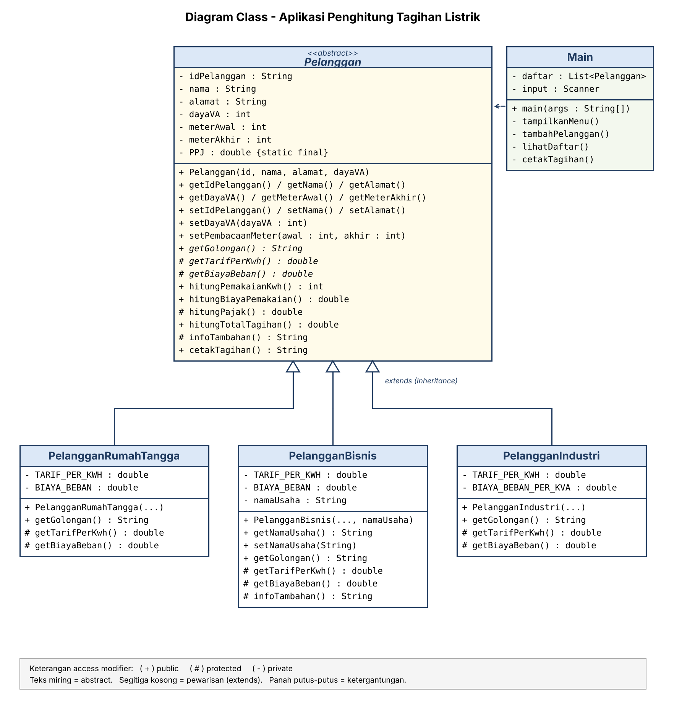

# Aplikasi Penghitung Tagihan Listrik

Tugas Ujian Tengah Semester (UTS) mata kuliah **Pemrograman Berbasis Objek**.

## Deskripsi

Aplikasi berbasis konsol (console) yang dibuat dengan bahasa Java untuk menghitung tagihan listrik bulanan pelanggan. Aplikasi mendukung tiga golongan pelanggan, yaitu Rumah Tangga, Bisnis, dan Industri, yang masing-masing memiliki tarif dan biaya beban berbeda.

Proyek ini dibuat untuk menerapkan dua prinsip pemrograman berorientasi objek:

1. **Access Modifier / Encapsulation**
2. **Inheritance**

## Fitur

- Menambah pelanggan dan menghitung tagihan
- Menampilkan daftar pelanggan
- Mencetak tagihan berdasarkan ID pelanggan
- Validasi input, misalnya meter akhir tidak boleh lebih kecil dari meter awal

## Rumus Perhitungan

```
Pemakaian (kWh) = Meter Akhir - Meter Awal
Biaya Pemakaian = Pemakaian x Tarif per kWh
PPJ             = (Biaya Pemakaian + Biaya Beban) x 10%
Total Tagihan   = Biaya Pemakaian + Biaya Beban + PPJ
```

Tarif yang digunakan adalah nilai simulasi untuk keperluan tugas, bukan tarif resmi PLN.

| Golongan | Tarif per kWh | Biaya Beban |
|---|---|---|
| Rumah Tangga | Rp1.444,70 | Rp15.000 |
| Bisnis | Rp1.699,53 | Rp50.000 |
| Industri | Rp1.114,74 | Rp35.000 x daya (kVA) |

## Penerapan Prinsip OOP

**Encapsulation**
- Atribut pada class `Pelanggan` dibuat `private` dan hanya diakses lewat getter dan setter.
- Setter memvalidasi data sebelum disimpan, misalnya menolak nama kosong atau daya yang bernilai nol.
- Method yang hanya dibutuhkan class turunan dibuat `protected`, sedangkan method yang dipakai class lain dibuat `public`.

**Inheritance**
- `Pelanggan` adalah superclass abstrak yang berisi data dan alur perhitungan.
- `PelangganRumahTangga`, `PelangganBisnis`, dan `PelangganIndustri` mewarisi `Pelanggan` dengan `extends` dan mengisi tarif serta biaya beban sesuai golongan.

## Struktur Repository

```
.
├── src/
│   └── tagihanlistrik/
│       ├── Pelanggan.java
│       ├── PelangganRumahTangga.java
│       ├── PelangganBisnis.java
│       ├── PelangganIndustri.java
│       └── Main.java
├── diagram_class.png
├── Laporan_UTS_PBO_Tagihan_Listrik.docx
└── README.md
```

## Diagram Class



## Cara Menjalankan

### Menggunakan NetBeans

1. Buat proyek baru: **File > New Project > Java with Ant > Java Application**. Beri nama `TagihanListrik` dan hapus centang **Create Main Class**.
2. Buat package `tagihanlistrik` pada **Source Packages**.
3. Salin lima file dari folder `src/tagihanlistrik` ke package tersebut.
4. Klik kanan `Main.java`, lalu pilih **Run File** (Shift+F6).
5. Gunakan menu pada jendela **Output**.

### Menggunakan Terminal

Jalankan dari folder utama repository (membutuhkan JDK 8 atau lebih baru):

```
mkdir out
javac -d out src/tagihanlistrik/*.java
java -cp out tagihanlistrik.Main
```

## Contoh Hasil

Rumah Tangga, 1300 VA, meter 1200 ke 1450 (250 kWh):

```
Biaya Pemakaian: Rp361.175
Biaya Beban    : Rp15.000
PPJ (10%)      : Rp37.618
TOTAL TAGIHAN  : Rp413.792
```

Contoh lain: pelanggan Bisnis dengan 600 kWh menghasilkan Rp1.176.690, dan pelanggan Industri 41.500 VA dengan 8.000 kWh menghasilkan Rp11.407.462.

## Laporan

Laporan lengkap beserta dokumentasi pengujian tersedia pada file `Laporan_UTS_PBO_Tagihan_Listrik.docx`.
